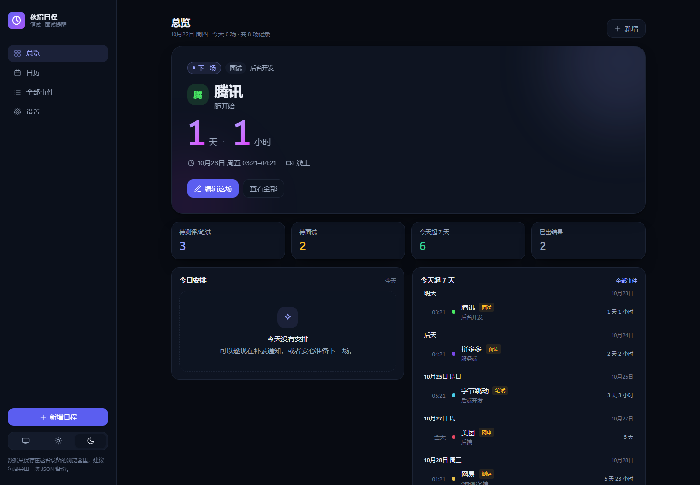
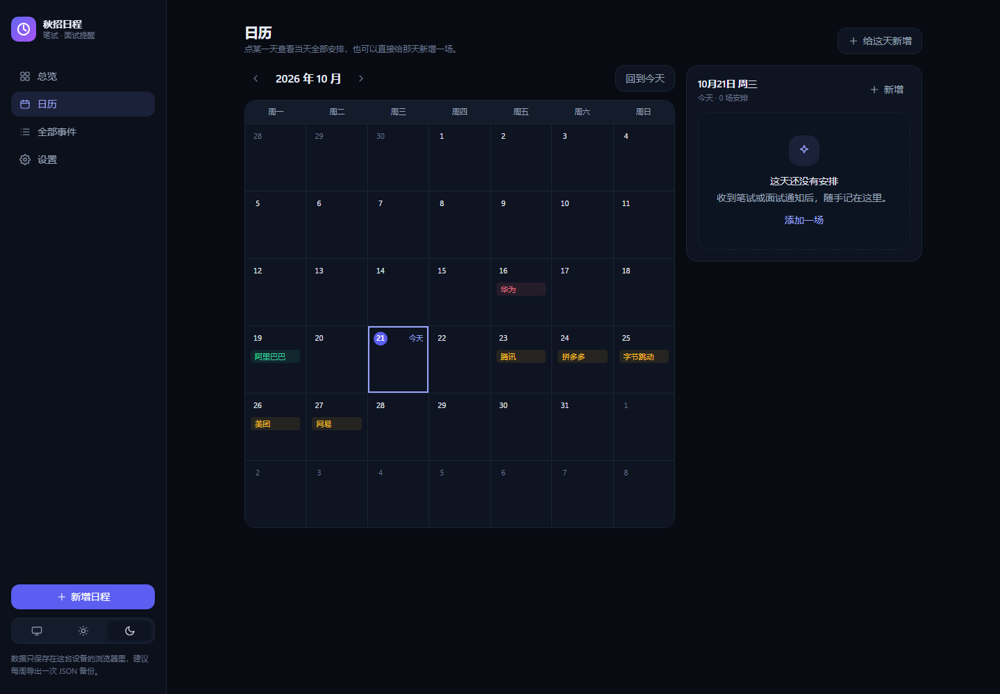
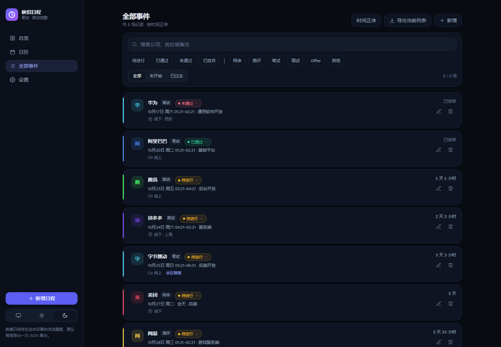
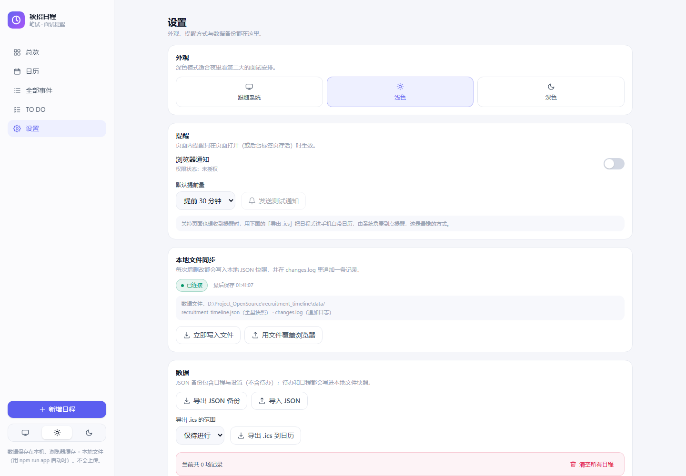
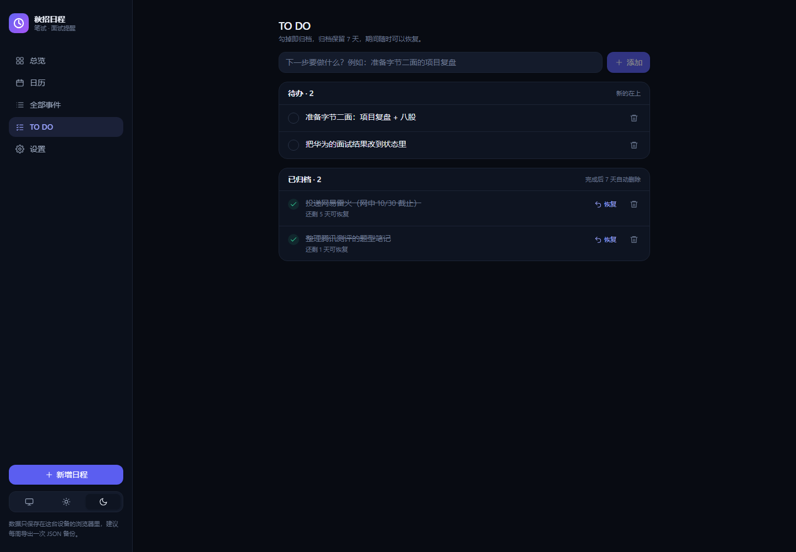
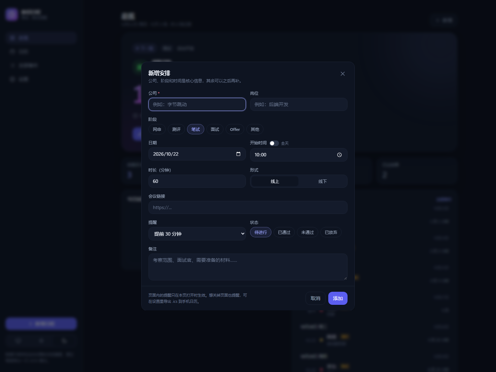
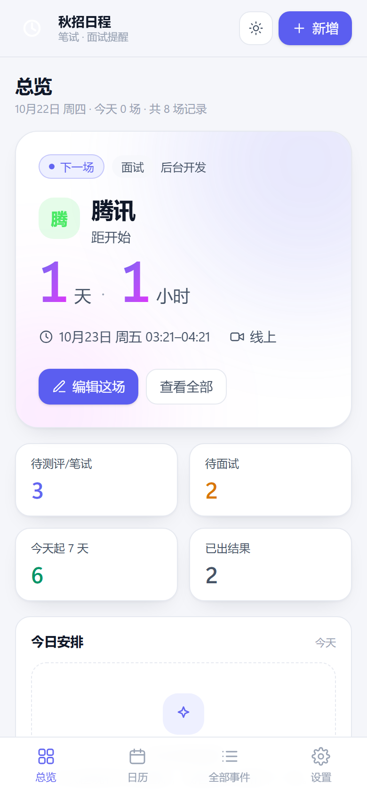

# 秋招日程 · recruitment-timeline

秋招笔试 / 面试的时间线提醒。纯前端、本地优先：不用注册、不用服务器，数据只存在自己的浏览器里。



## 它解决什么问题

秋招通知散落在邮件、群消息和招聘 App 里，笔试、面试、网申截止混在一起特别容易漏。这个页面把这些时间点收进一张时间线，用「天 / 时」倒计时盯住下一场，并且能把日程一键导出到手机日历，由系统负责到点提醒。

## 功能

- **天 / 时倒计时**：不需要精确到秒。`3 天 4 小时`、`5 小时`、`不到 1 小时`、`进行中` 会随剩余时间自动切换；每 30 秒刷新一次，不做每秒重渲染。
- **总览**：下一场大卡片、待测评·笔试 / 待面试 / 近 7 天 / 已出结果统计、今日时间线、近 7 天日程、过期未标记提醒。
- **TO DO**：左侧栏的待办清单。拖动左侧把手调整优先级（聚焦把手后也能用 ↑ ↓），每行带编辑和删除；勾掉即归档，归档保留 7 天（每条显示还剩几天可恢复），超过 7 天自动删除；完成和删除都能撤销。
- **日历**：周一起始的月视图，每天最多 3 个公司小条（移动端显示为圆点），点某天看当天全部安排，也能直接给那天新增。
- **全部事件**：按公司 / 岗位 / 备注搜索，按状态和阶段多选筛选，按时间正序倒序，可导出当前筛选结果。
- **状态流转**：待进行 / 已通过 / 未通过 / 已放弃；卡片上直接切换，删除后 5 秒内可撤销。
- **提醒**：提前 0 / 15 / 30 / 60 / 120 分钟或 1 天，外加开场提醒；浏览器通知 + 页面标题显示下一场剩余时间。
- **全天事件**：网申截止这类只有日期的节点，当天 09:00 提醒。
- **数据**：JSON 备份导出、导入（合并 / 覆盖两种方式），清空需二次确认；数据损坏时自动备份原文而不是直接丢。
- **.ics 导出**：带 `VALARM` 提醒，导入手机日历后由系统在到点提醒（关掉网页有效）。
- **PWA**：可安装到桌面，离线也能打开（需要 HTTPS 或 localhost）。
- **其他**：深浅主题（含跟随系统）、移动端底部导航、`n` 快捷键新增。

## 快速开始

```bash
npm install
npm run app        # 推荐：构建 + 启动，页面和本地文件同步都在 http://127.0.0.1:5173
npm run dev        # 只改前端代码时用；要文件同步需另开一个终端跑 npm run store
npm run build      # 生产构建，产物在 dist/
npm run preview    # 只预览构建产物（没有文件同步）
```

环境要求：Node `^20.19` / `>=22.12`（Vite 8 的要求），本项目在 Node 24 上开发。

| 命令 | 说明 |
| --- | --- |
| `npm run app` | **日常使用**：构建 + 启动页面（5173），并把数据写进 `data/` |
| `npm run store` | 只启动本地文件服务（给 `npm run dev` 的 `/api` 代理用） |
| `npm run dev` | 开发服务器（HMR） |
| `npm run build` | 类型检查 + 生产构建 |
| `npm run typecheck` | 只做类型检查 |
| `npm test` | Vitest 单元 / 集成测试 |
| `npm run preview` | 预览 `dist/` |
| `npm run icons` | 重新生成 PWA 图标（纯 Node 手写 PNG，无额外依赖） |

## 提醒是怎么工作的

| 场景 | 行为 |
| --- | --- |
| 页面开着（前台或后台标签页） | 每 20 秒检查一次触发点，命中就发浏览器通知；需要先在设置里授权 |
| 页面关掉 | 不会提醒。用「设置 → 导出 .ics」把日程导入手机 / 系统日历，由系统负责到点提醒 |
| 触发点已过去超过 1 小时 | 不补发，避免打开页面时被过期提醒刷屏 |
| 全天事件 | 当天 09:00 提醒，提前量按分钟折算（例如提前 1 天 = 前一天 09:00） |

页面标题也会跟着变，例如 `1 天 1 小时 · 【腾讯】面试 · 秋招日程`。

> 浏览器通知的可靠性边界是「页面或 Service Worker 还活着」。要保证关掉网页也能响，`.ics` + 手机日历才是可靠的那一层。

## 数据持久化：浏览器 + 本地文件

`npm run app` 启动的本地服务**同时托管页面和写入接口**，不需要数据库：

- `data/recruitment-timeline.json`：全量快照，`{ schemaVersion, revision, savedAt, data: { events, todos, settings } }`，原子写入（先写 `.tmp` 再改名）。
- `data/changes.log`：追加式 JSONL，每次写入一行，记录本次改动涉及哪些记录：

```json
{"at":"2026-10-21T17:39:35.517Z","revision":2,"changes":[{"entity":"todo","action":"add","id":"f75bd…","label":"投递拼多多"}]}
```

具体行为：

- 启动时先读 `/api/state`：文件比浏览器里的新，就把文件内容灌回 `localStorage` 再渲染，所以换浏览器、清缓存都不会丢。
- 每次新增 / 修改 / 删除 / 排序后 400ms 合并一次，写快照并追加一条日志（含 `entity`、`action`、`id`、`label`、变化的字段）。
- 服务没启动时退回纯浏览器模式，改动照常保存；下次连接后自动补写文件。
- 设置页有「立即写入文件」和「用文件覆盖浏览器」两个手动按钮。
- 端口和数据目录可用环境变量覆盖：`RT_PORT`（默认 5173）、`RT_DATA_DIR`（默认 `./data`）。
- `data/` 默认在 `.gitignore` 里；想用 git 备份数据，删掉那一行即可。

> 注意：`/api` 只在 `npm run app`（或 `npm run store` + dev）时存在；只用静态托管部署时没有文件同步，只有浏览器存储。

## 数据存在哪

- 浏览器 `localStorage`：`rt.v1.events`、`rt.v1.todos`、`rt.v1.settings`、`rt.v1.notified`、`rt.v1.syncedAt`（最后一次写入文件的时间）。
- 本地文件：`data/recruitment-timeline.json` 与 `data/changes.log`（见上一节）。
- 读取时做结构校验和字段修复；JSON 解析失败会把原文另存到 `rt.v1.<key>.corrupt.<时间戳>`，界面以空列表启动并提示，不会静默丢数据。
- 无痕模式等写入失败时降级为内存态，并在顶部显示警示条。
- 多标签页通过 `storage` 事件自动同步；JSON 备份包含日程与设置（不含待办，待办会进本地文件快照）。

## .ics 导出说明

- 录入的是本地墙钟时间，导出时换算成 UTC（`...Z`），手机日历按你的时区正常显示。
- 定时事件用相对触发 `TRIGGER:-PT30M`；全天事件用绝对触发，固定在当天 09:00 前提醒。
- 严格遵守 RFC 5545：CRLF 换行、75 字节折行（不会把中文劈开）、转义 `\ ; , 换行`。
- 导出范围可选「仅待进行」或「全部事件」；全部事件页也能直接导出当前筛选结果。

## 部署与安装成 App

- 本地日常使用：`npm run app`，打开 `http://127.0.0.1:5173`（页面、Service Worker、通知、本地文件同步都可用）。
- 只预览构建：`npm run preview` → `http://localhost:4173`（没有文件同步接口）。
- 手机使用：需要 HTTPS 的静态托管（GitHub Pages、Netlify、Vercel 等），局域网 `http://192.168.x.x` 无法注册 Service Worker。
- 安装：Chrome / Edge 地址栏右侧「安装」，iOS Safari「添加到主屏幕」。
- 注意：静态托管时数据只在各自浏览器里，手机和电脑不会自动同步；本地 `data/` 文件可以复制或放进网盘。`http://127.0.0.1:5173` 和 `http://localhost:5173` 是两个不同的存储来源，选定一个用。

## 技术栈与目录

Vite 8 + React 19 + TypeScript 6 + Tailwind CSS 4 + Vitest 5，运行时零 UI 依赖（路由、日期处理、PWA 都是自己写的）。

```
scripts/local-store.mjs  本地文件服务：静态托管 + /api/state（JSON 快照 + JSONL 日志）
src/
  types.ts              数据模型与常量（阶段、状态、提醒选项）
  lib/                  date（倒计时/月历/分组）、ics、notify、conflict、colors、todos、sync、download
  store/                storage（校验/迁移/损坏兜底）、useEvents、useTodos、useSettings、importExport
  hooks/                useNow、useHashRoute、useNotifications、useFileSync
  components/           布局、卡片、倒计时、月历、表单、筛选、Toast、确认框
  views/                总览 / 日历 / 全部事件 / TO DO / 设置
  test/                 单元与集成测试
public/                 manifest、sw.js、生成的图标
scripts/gen-icons.mjs   纯 Node 生成 PNG 图标
```

## 测试

```bash
npm test   # 89 个用例
```

覆盖倒计时边界（整 72 小时、跨天、全天、进行中）、近 7 天时间窗、待办归档的 7 天边界与恢复、拖动排序与旧数据顺序迁移、月历矩阵（跨年、2 月）、按天分组、`.ics` 的折行 / 转义 / UTC / VALARM、本地文件同步的变更 diff 与快照回写、存储损坏兜底与字段修复（含旧版本「HR 面」并入面试）、通知触发与去重、备份合并策略、表单校验，以及把整个 App 挂起来的集成用例。

## 边界与不做的事

- 单用户、单机数据；没有账号、云同步和多人协作（本地文件可以自己放网盘 / git）。
- 时间按设备本地时区理解（预期 Asia/Shanghai），不做多时区换算。
- 不做周期性事件、Excel / CSV 批量导入、关闭浏览器后的后台推送。

## 更多截图

| 日历 | 全部事件 |
| --- | --- |
|  |  |

| 设置（浅色） | TO DO |
| --- | --- |
|  |  |

| 新增表单 | 移动端总览 |
| --- | --- |
|  |  |
